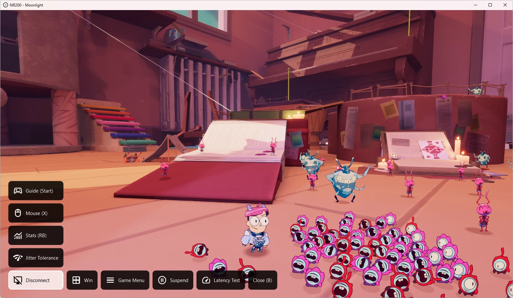
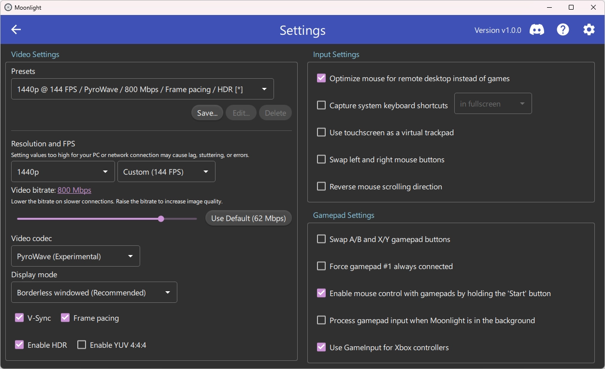

# MoreOrLessSoftware Moonlight PC

This is a fork of the original Moonlight PC (https://github.com/moonlight-stream/moonlight-qt/releases).

Some features are designed to work with MoreOrLessSoftware Sunshine (https://github.com/MoreOrLessSoftware/Sunshine), but it should work well with any Sunshine-compatible host.

## New In This Fork

### Overlay Menu

An in-stream menu, drawn over the stream without interrupting it.

- Open it by holding a gamepad button combination (configurable, e.g. Start / Menu, Select / Back / View, Guide / Home or LB + RB) or with Ctrl+Alt+Shift+O. Navigate it with a gamepad, the keyboard or the mouse.
- Custom commands: buttons that press key combinations on the host, set up in the settings with a key recorder and an icon chooser.
- Host commands: MoreOrLessSoftware Sunshine hosts can define their own commands, including groups for the program in the foreground, which appear in the menu automatically.
- Disconnect and Quit Session.

### Video Presets

Save the Video Settings (resolution, frame rate, codec, bitrate, display mode, V-Sync, frame pacing, HDR and 4:4:4) as named presets, then switch between them from the settings page or the toolbar, or launch an app with a preset from its context menu. Presets can be renamed, reordered and deleted, and `--preset <name>` selects one from the command line.

### Frame Pacing

With frame pacing on, frames are presented on the host's own capture cadence instead of the display's V-blank, which reduces latency. The host's timing jitter is smoothed out and frames wait only as long as recent network jitter requires. Works in both borderless windowed (recommended) and full-screen modes.

> **VRR clients:** frame pacing should generally be on with a variable refresh rate (G-SYNC / FreeSync) display, which refreshes the moment each frame arrives, so frames appear evenly spaced at the host's frame rate even when it doesn't match the display's refresh rate. On a fixed refresh rate display, the Tearing setting is what lowers latency, at the cost of visible tearing.

Frame Pacing settings:
- **Tearing**: tear for the lowest latency until the stream reaches a chosen share of the refresh rate, or never.
- **Network jitter tolerance**: Lowest latency, Balanced or Smoothest.
- **Cadence smoothing**: on or off.

### AMF Decoding

On AMD GPUs on Windows, HEVC is decoded with AMD's AMF decoder in its low latency mode, which roughly halves decode time compared with D3D11VA on recent APUs. It falls back to D3D11VA where AMF isn't available.

### PyroWave

Support for [PyroWave](https://github.com/Themaister/pyrowave), an experimental wavelet codec for very low latency at very high bitrates on a wired LAN. Decoding runs in Vulkan compute on the GPU, with 4:2:0 and 4:4:4 and HDR support, on Windows and Linux. Requires a host that can encode PyroWave. Late frames are shown partially decoded at their deadline rather than dropped.

### Bitrate and Error Correction

- With the bitrate limit unlocked, bitrates up to 2500 Mbps; any value can be typed in.
- An error correction setting chooses how much FEC the host sends: the host's setting, off, or a custom percentage (requires a compatible host).

### Performance Stats Overlay

- Capture-to-present latency (using the host's clock where synced), frame receive time, and video and network bitrates.
- Decode and render times measured to when the GPU finishes, so the latency figures add up.
- A choice of text color, and a latency measurement mode (Ctrl+Alt+Shift+S cycles off, on, latency mode) that moves the overlay for camera-based latency tests.

### Input

- GameInput support for Xbox controllers on Windows, for lower input latency, the Guide and Share buttons, Elite paddles and impulse trigger rumble.
- Ctrl+Alt+Shift+W disconnects without quitting the host app.

### Other

- Reorganized settings page.
- Linux build (AppImage) with frame pacing and PyroWave.
- The machine's host name is sent as the device name when pairing.

## Building

See instructions from the base repository: https://github.com/moonlight-stream/moonlight-qt#building
