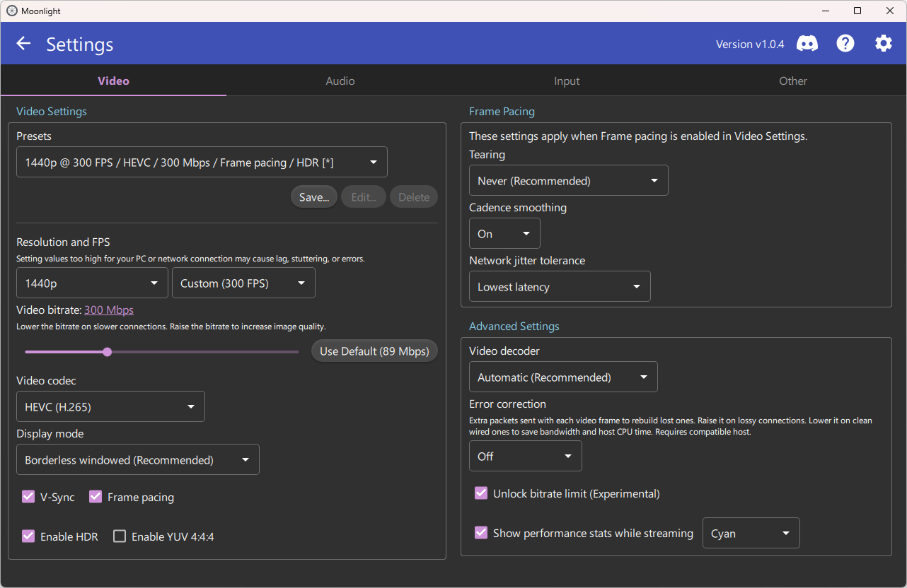
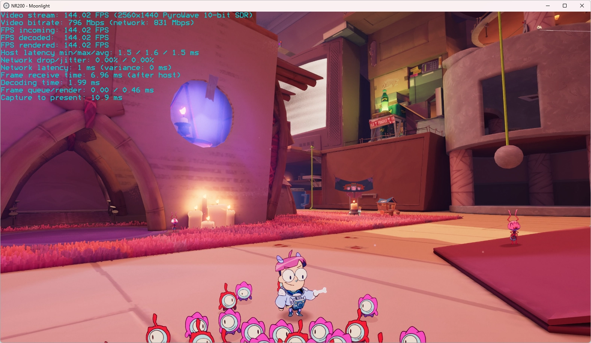
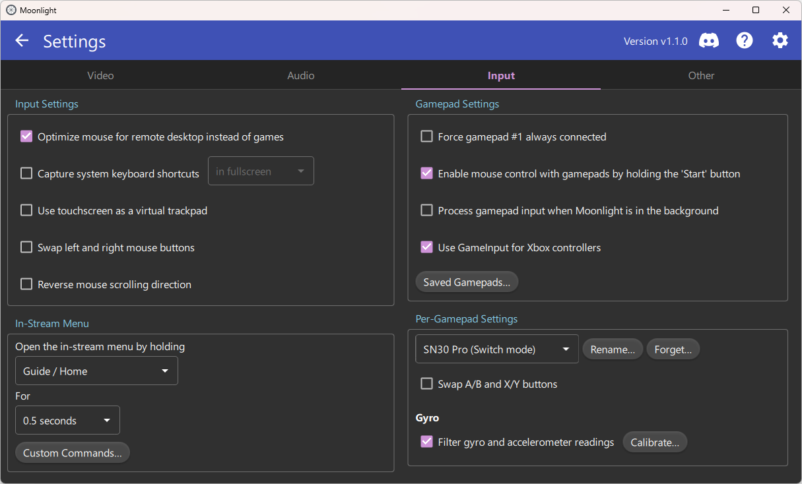
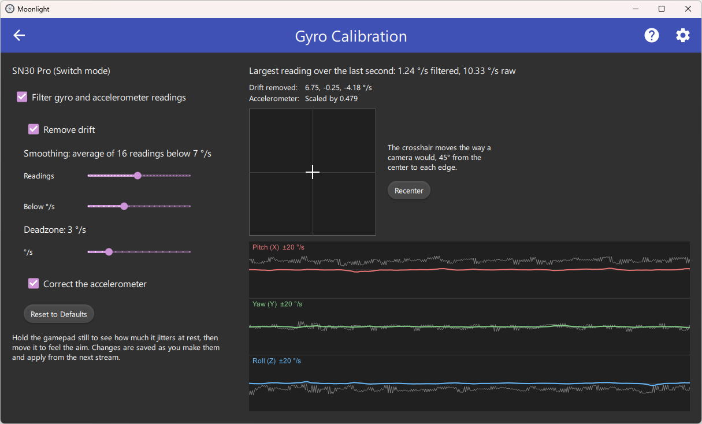

# MoreOrLessSoftware Moonlight PC

This is a fork of the original Moonlight PC (https://github.com/moonlight-stream/moonlight-qt). Builds for Windows and Linux are on the [releases page](https://github.com/MoreOrLessSoftware/moonlight-qt/releases).

It is the companion to [MoreOrLessSoftware Sunshine](https://github.com/MoreOrLessSoftware/Sunshine), the host. Some features are designed to work with it, but this client should work well with any Sunshine-compatible host. Where a feature needs the host's help, it is linked to the matching section of the Sunshine README below.

There is also a [MoreOrLessSoftware Moonlight for Android](https://github.com/MoreOrLessSoftware/moonlight-android) client; see its README for which of these features it has.

## New In This Fork

### Overlay Menu

An in-stream menu, drawn over the stream without interrupting it.

- Open it by holding a gamepad button combination (configurable, e.g. Start / Menu, Select / Back / View, Guide / Home or LB + RB) or with Ctrl+Alt+Shift+O. Navigate it with a gamepad, the keyboard or the mouse.
- Custom commands: buttons that press key combinations on the host, set up in the settings with a key recorder and an icon chooser.
- Host commands: MoreOrLessSoftware Sunshine hosts can define their own [client commands](https://github.com/MoreOrLessSoftware/Sunshine/blob/mlsoft-custom/docs/client_commands.md), including groups for the program in the foreground, and commands added by [plugins](https://github.com/MoreOrLessSoftware/Sunshine/blob/mlsoft-custom/docs/plugins.md). They appear in the menu automatically.
- Disconnect and Quit Session.

### Video Presets

Save the Video Settings (resolution, frame rate, codec, bitrate, display mode, V-Sync, frame pacing, HDR and 4:4:4) as named presets, then switch between them from the settings page or the toolbar, or launch an app with a preset from its context menu. Presets can be renamed, reordered and deleted, and `--preset <name>` selects one from the command line.

### Frame Pacing

With frame pacing on, frames are presented on the host's own capture cadence instead of the display's V-blank, which reduces latency. The host's timing jitter is smoothed out and frames wait only as long as recent network jitter requires. Works in both borderless windowed (recommended) and full-screen modes. It works best with MoreOrLessSoftware Sunshine, which [captures frames as soon as the desktop presents them](https://github.com/MoreOrLessSoftware/Sunshine#latency-and-frame-pacing) and can smooth the uneven frames that frame generation produces.

> **VRR clients:** frame pacing should generally be on with a variable refresh rate (G-SYNC / FreeSync) display, which refreshes the moment each frame arrives, so frames appear evenly spaced at the host's frame rate even when it doesn't match the display's refresh rate. On a fixed refresh rate display, the Tearing setting is what lowers latency, at the cost of visible tearing.

Frame Pacing settings:
- **Tearing**: tear for the lowest latency until the stream reaches a chosen share of the refresh rate, or never.
- **Network jitter tolerance**: Lowest latency, Balanced or Smoothest.
- **Cadence smoothing**: on or off.

### AMF Decoding

On AMD GPUs on Windows, HEVC is decoded with AMD's AMF decoder in its low latency mode, which roughly halves decode time compared with D3D11VA on recent APUs. It falls back to D3D11VA where AMF isn't available.

### PyroWave

Support for [PyroWave](https://github.com/Themaister/pyrowave), an experimental wavelet codec for very low latency at very high bitrates on a wired LAN. Decoding runs in Vulkan compute on the GPU, with 4:2:0 and 4:4:4 and HDR support, on Windows and Linux. Requires a host that can encode PyroWave, such as [MoreOrLessSoftware Sunshine](https://github.com/MoreOrLessSoftware/Sunshine#pyrowave), which encodes it on Windows only. Late frames are shown partially decoded at their deadline rather than dropped.

### Bitrate and Error Correction

- With the bitrate limit unlocked, bitrates up to 2500 Mbps; any value can be typed in.
- An error correction setting chooses how much FEC the host sends: the host's setting, off, or a custom percentage (requires a compatible host, such as [MoreOrLessSoftware Sunshine](https://github.com/MoreOrLessSoftware/Sunshine#error-correction)).

### Performance Stats Overlay

- Capture-to-present latency (using the host's clock, which MoreOrLessSoftware Sunshine [answers sync requests for](https://github.com/MoreOrLessSoftware/Sunshine#latency-and-frame-pacing)), frame receive time, and video and network bitrates.
- Decode and render times measured to when the GPU finishes, so the latency figures add up.
- A choice of layouts: Minimal and Compact (one line, optionally with total latency), Basic and Detailed. Pick one in the settings or from the overlay menu; Ctrl+Alt+Shift+S toggles it.
- A choice of text color, and a *Detailed (offset from top)* layout that moves the overlay for camera-based latency tests. Sunshine's *Latency Test* plugin shows the test pattern for these, and its per-frame latency trace and CSV can be matched against this client's traces.

### Input

- GameInput support for Xbox controllers on Windows, for lower input latency, the Guide and Share buttons, Elite paddles and impulse trigger rumble.
- Ctrl+Alt+Shift+W disconnects without quitting the host app.

### Per-Gamepad Settings

Settings for each gamepad, on the Input tab. Gamepads are remembered by their serial (a Bluetooth controller's address), so two of the same model keep separate settings.

- Rename a gamepad; default names include the end of its address.
- Swap A/B and X/Y (a Nintendo-style layout) for each gamepad.
- Forget a gamepad's settings, or open **Saved Gamepads…** to forget any gamepad with saved settings, connected or not.

### Gyro Filtering

Optional filtering of gyro and accelerometer readings for gamepads with a gyro, for controllers too noisy or drifty to use (or for Steam to calibrate) as they are. Off unless turned on for a gamepad.

- Removes drift while the gamepad is held still.
- Smooths small movements and applies a small deadzone, leaving fast movements untouched.
- Corrects the accelerometer's scale.

**Calibrate…** opens a live view with a crosshair and graphs of raw and filtered readings, to tune the smoothing and deadzone while moving the gamepad.

### Other

- Reorganized settings page.
- Linux build (AppImage) with frame pacing and PyroWave.
- The machine's host name is sent as the device name when pairing.

## Building

See instructions from the base repository: https://github.com/moonlight-stream/moonlight-qt#building

## Downloads

[Download for Windows and Linux from releases](https://github.com/MoreOrLessSoftware/moonlight-qt/releases)

## Credits

This is a fork of [Moonlight PC](https://github.com/moonlight-stream/moonlight-qt), authored by [Cameron Gutman](https://github.com/cgutman) and others. PyroWave decoding uses [PyroWave](https://github.com/Themaister/pyrowave) by Hans-Kristian Arntzen.
